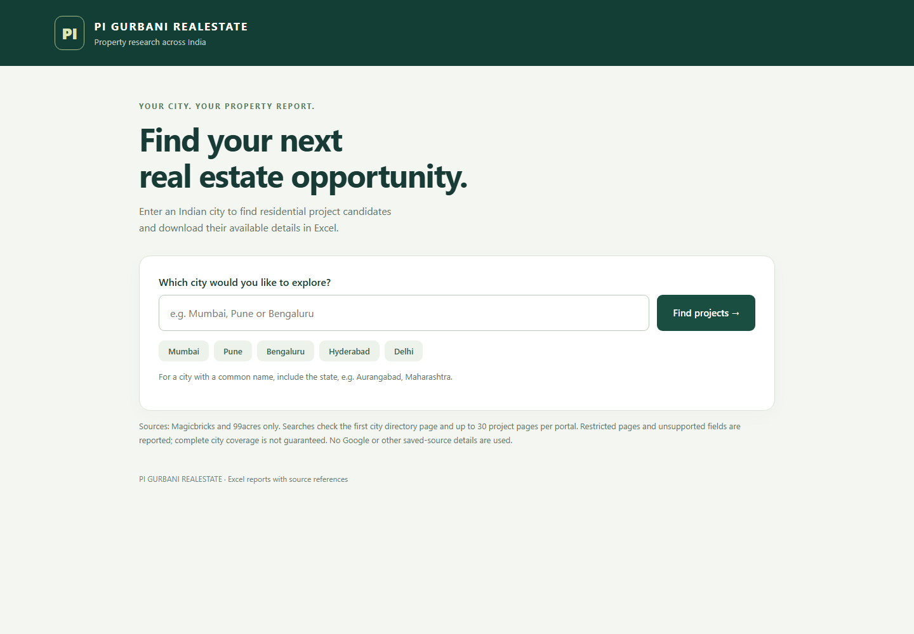
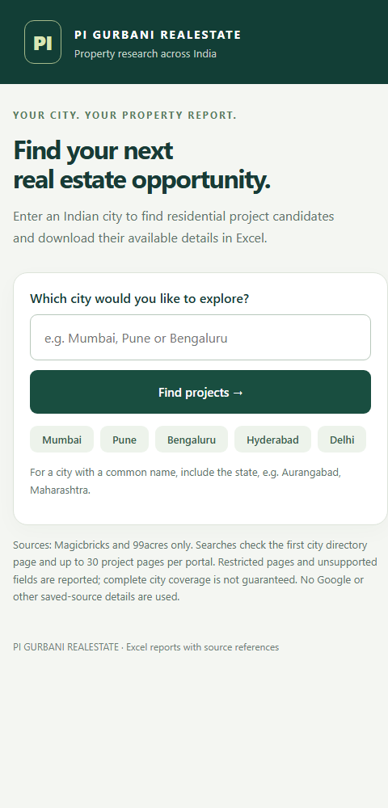

<div align="center">

# PI GURBANI REALESTATE

**Explore a city. Review project candidates. Export your research.**

A local Python web app for discovering residential project candidates on Magicbricks and 99acres and organizing available details in Excel.

Python 3.10+ | Browser interface | Excel exports | Source references

[Quick start](#quick-start) | [Screenshots](#screenshots) | [How it works](#how-it-works) | [Limitations](#limitations)

</div>

## Screenshots

### Desktop search



Enter a city or choose a shortcut to start researching available project pages.

<details>
<summary><strong>View the compact layout</strong></summary>
<br>


</details>

Screenshots show the current local app. Search results vary with portal availability.

## Features

- **City-based discovery:** search Indian cities, with Bengaluru/Bangalore and Gurugram/Gurgaon aliases.
- **Project preview:** review the first ten candidates before downloading the full report.
- **Excel reports:** separate Projects, Project Units and Read me worksheets.
- **Source visibility:** retain source URLs, extraction status and retrieval timestamps.
- **Partial results:** accessible pages still contribute when another portal fails.
- **Clear diagnostics:** distinguish network failures, HTTP denials and unsupported pages.

## Quick start

### Windows

1. Install Python 3.10 or newer and enable **Add Python to PATH**.
2. Download or clone the project and extract it if necessary.
3. Double-click `run_windows.bat`. The launcher installs dependencies and opens the app.
4. Enter a city, select **Find projects**, then **Download Excel**.

Keep the launcher running while using the app. No Google API key is needed for this version.

### Manual setup

Run inside the project folder:

```sh
python -m venv .venv
```

Activate on Windows PowerShell:

```powershell
.\.venv\Scripts\Activate.ps1
```

Or on macOS/Linux:

```sh
source .venv/bin/activate
```

Install and launch:

```sh
python -m pip install -r requirements.txt
python app.py
```

Open **http://127.0.0.1:8000**. For a Mumbai export directly from the command line, run `python main.py`.

## How it works

1. Read the first city project-directory page on each supported portal.
2. Inspect up to 30 discovered project pages per portal.
3. Extract supported published fields and structured floor plans where available.
4. Preview candidates and save a timestamped workbook in `output/`.

## Excel output

| Worksheet | Contents |
| --- | --- |
| Projects | Project identity, supported overview fields, source references and research status |
| Project Units | Supported configurations and areas, with provenance where available |
| Read me | Search scope, source diagnostics and interpretation notes |

Missing numeric values remain blank. Prices, project status and phase totals require verification; the app does not invent missing details.

## Limitations

This is a research aid, not a complete property database or live price feed. The app only checks the first directory page per portal. Sites may deny automated requests, require JavaScript, change layout or exceed the page-size limit. Some candidates may have only a name and source URL.

The app respects its robots checks and does not bypass logins or CAPTCHA. If no candidates are accessible, it reports the problem without creating an empty workbook. Google Places, developer websites and the older `project_details.json` research snapshot are not used in the current discovery flow.

## Troubleshooting

| Message | Next step |
| --- | --- |
| Connection failed | Check outbound network access, DNS, proxy and firewall settings; launch from your normal terminal |
| HTTP 403 | The portal denied the request; available results from the other portal can still export |
| HTTP 429 | Wait before trying again |
| No supported project links | The page may require JavaScript or its layout may have changed |
| Page too large | That page exceeded the download limit and was skipped |
| Cannot save workbook | Check folder permissions and close any locked output file |

Temporary connection errors, timeouts and HTTP 502/503/504 failures are retried up to twice. Access denials and rate limits are not retried. A Retry-After response defers retries to a later search.

## Share a temporary demo

With the app running and Cloudflare Tunnel installed:

```sh
cloudflared tunnel --url http://127.0.0.1:8000
```

Share the generated HTTPS URL. Keep the computer awake and both processes running. Anyone with the link can access the app. The localhost address only works on the computer hosting the app. Temporary tunnel links are intentionally not committed to this README.

## Project structure

```text
app.py                 Local web server and search jobs
main.py                Excel report generation
portals.py             Portal discovery and project extraction
enrichment.py          HTTP fetching and structured-data parsing
web/index.html         Browser interface
docs/screenshots/      README screenshots
requirements.txt       Python dependencies
run_windows.bat        Windows launcher
test_*.py              Automated checks
output/                Generated reports
```

## Development

```sh
python -m unittest discover -p "test_*.py"
```

Tests cover source boundaries, retry behavior, extraction and workbook generation. Live portal access is environment-dependent and is not guaranteed by unit tests. Keep `.env`, generated reports and local runtime files out of commits.
